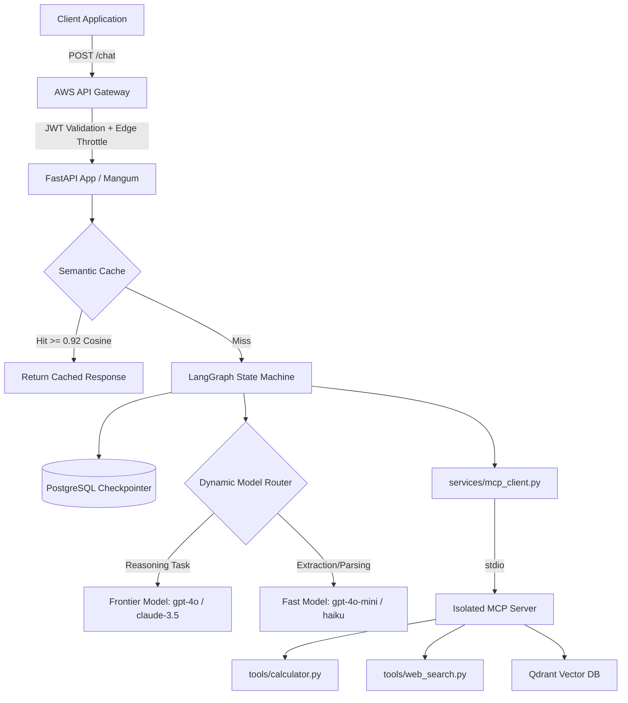

# MCP AI Gateway - Production Serverless Architecture

A production-grade, asynchronous FastAPI backend orchestrating multi-agent AI workflows using the **Model Context Protocol (MCP)**. 

Designed for high-throughput enterprise environments, this gateway is containerized and deployed to **AWS Lambda** (Linux/arm64) behind an API Gateway, utilizing strict dual-layer rate limiting, Firebase JWT authentication, and zero-plaintext secret management.

**Live Architecture Demo:** [dbaichat.space](https://dbaichat.space) | Interactive Swagger UI: `/docs`

---

## Core Architecture & Execution Flow

The system orchestrates two primary AI pipelines that share a unified set of enterprise tools, isolated and served over standard IO streams via MCP.



    
```text
POST /chat/mcpAgentChat ─► services/agent_service.py   (LangChain Agent; stateless execution)
POST /chat/documents    ─► services/rag_agent/          (LangGraph Agent; strict state machine)
                                 │
                                 ▼
                    services/mcp_client.py  ── stdio ──►  mcp_server/ (Isolated execution)
                    (MCP client, session cache)            ├─ calculate    tools/calculator.py
                                                           ├─ search_jobs  tools/jobs.py
                                                           └─ search_web   tools/web_search.py
```

### Key Engineering Decisions
*   **Stateful Orchestration (LangGraph):** The RAG pipeline relies on a strict state machine to prevent infinite tool-calling loops, enforce `recursion_limits`, and manage token context windows dynamically.
*   **Isolated Tool Execution (MCP):** The `mcp_server/` defines all tools as pure, unit-testable Python functions. The LLM reasoning layer is entirely decoupled from tool execution.
*   **Prompt Guardrails:** Third-party API responses (like Web Search or Jobs) are strictly wrapped in `<untrusted_data>` boundaries (`prompts/guard.py`) to prevent prompt injection and force the LLM to treat external outputs as data, not instructions.

---

##  Enterprise Security & Infrastructure

This gateway implements several layers of production hardening specifically designed for serverless AI deployments.

### 1. Dual-Layer Authentication & Authorization
Anonymous traffic never reaches the Lambda function, completely neutralizing unauthorized LLM API spend.
*   **Edge Auth:** AWS API Gateway utilizes a JWT authorizer (`FirebaseJwt`) to validate the Firebase ID token signature, expiry, and issuer at the edge. 
*   **Application Auth:** `middleware/firebase_middleware.py` re-verifies the token using the Firebase Admin SDK, attaching the `uid` to `request.state.user` for strict multi-tenant data isolation (e.g., Qdrant vector retrieval is scoped strictly per user).

### 2. Secure Config Management (AWS SSM)
To achieve zero-plaintext secrets, all configuration and API keys (OpenAI, Firebase, Qdrant) are dynamically fetched from **AWS Systems Manager (SSM) Parameter Store** using `SecureString` KMS encryption.
*   Secrets are injected at Lambda cold-start via `config.py` using strict prefix namespaces (e.g., `/mcpbe/prod/*`).
*   No secrets exist in the Docker image, Git history, or plain Lambda environment variables. 

### 3. Cost-Optimized Rate Limiting
*   **Global Infrastructure Throttle:** AWS API Gateway enforces a hard cap (`ThrottlingRateLimit: 10/sec`, `Burst: 20`) to act as a fail-safe against DDoS or runaway LLM loops.
*   **Per-User Application Limits:** `slowapi` enforces strict endpoint quotas (e.g., `5/minute` on inference routes) keyed to the authenticated Firebase `uid`.

---

## Continuous Evaluation & Testing

Relying on "vibe checks" is insufficient for production AI. This repository enforces two strict testing gates (`.github/workflows/pr-check.yml`):

### 1. Deterministic Unit Testing (`pytest`)
The core orchestration logic, Qdrant connections, and cache stampede mitigations are fully mocked and tested offline. Commits enforce an 80% diff-cover threshold before merging. 

### 2. Automated LLM Evaluation (`evals/`)
The system utilizes continuous evaluation pipelines to catch regressions before they reach production:
*   **RAG Quality (`evals/rag/`):** Evaluates retrieval and reranking pipelines against a golden dataset, generating deterministic metrics (Recall@5, MRR, NDCG@5) and Ragas frameworks (Faithfulness, Answer Relevance). 
*   **Agent Behavior (`evals/agent/`):** Utilizes `deepeval` to ensure strict tool-picking accuracy, memory retention, and safety guardrail adherence.

---

## 🚀 Deployment Pipeline (AWS SAM)

The application is containerized (`Dockerfile` via `public.ecr.aws/lambda/python:3.12`) to support compiled C-dependencies (like `PyMuPDF` for document parsing) on Lambda's `arm64` architecture. 

The `template.yaml` defines the Infrastructure as Code (IaC), allowing rapid, repeatable deployments via the AWS Serverless Application Model (SAM) CLI. `lambda_handler.py` wraps the FastAPI app with `mangum` to handle the API Gateway event translation.

```bash
# 1. Build the Lambda container image
sam build

# 2. Deploy CloudFormation stack, ECR repo, Lambda, and API Gateway
sam deploy \
  --stack-name mcpbe-backend \
  --region us-east-1 \
  --resolve-image-repos \
  --resolve-s3 \
  --capabilities CAPABILITY_IAM \
  --parameter-overrides AppEnv=prod
```

## 📂 Repository Structure Highlights

```text
├── .github/workflows/          # CI/CD pipelines (pr-check.yml, deploy.yml)
├── evals/                      # Offline LLM Evaluation frameworks (DeepEval, Ragas)
├── mcp_server/                 # Model Context Protocol tools and server
├── middleware/                 # Request interceptors (rate_limiter, firebase auth)
├── prompts/                    # Version-controlled prompt engineering
├── services/                   # Core Business & AI Logic (LangGraph, Vector Search)
├── tests/                      # Extensive unit testing suite
├── lambda_handler.py           # Serverless execution entry point for AWS (Mangum)
├── template.yaml               # AWS SAM Infrastructure as Code
└── main.py                     # FastAPI application factory
```
