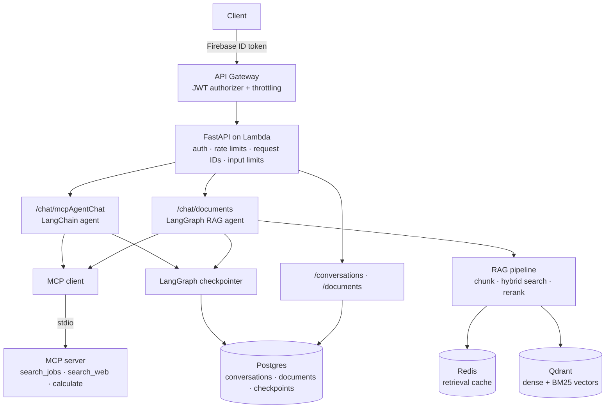

# MCPBE - Agentic Backend

A production, serverless agentic backend built on FastAPI. Two tool-calling agents (LangGraph and
LangChain) reason over each user's own documents with hybrid RAG, and act through tools served by
a standalone **Model Context Protocol (MCP)** server: live job search, web search and calculation.
Agent state persists in **Postgres**, retrieval is cached in **Redis**, and every user's data is
isolated end to end.

Runs on **AWS Lambda** (container image) behind **API Gateway**, provisioned with **AWS SAM** and
shipped through GitHub Actions.


---

## Highlights

- **Two agents, one toolset.** A LangChain tool-calling agent and a LangGraph RAG agent share tools exposed by a standalone MCP server (job search, web search, calculator).
- **Hybrid RAG with citations.** Dense embeddings + BM25 in Qdrant, LLM reranking (top 40 → top 5), and answers that cite the exact chunk they came from (`[resume.pdf#3]`).
- **Durable conversation memory.** LangGraph checkpoints in Postgres, one thread per conversation, ownership-checked on every request.
- **Retrieval cache with stampede protection.** Redis cache-aside with versioned keys, per-user invalidation and a distributed singleflight lock.
- **Multi-tenant by design.** Every vector search, SQL query, cache key and memory thread is scoped to the authenticated user.
- **Defence in depth.** Firebase JWT verified at the API Gateway and again in the app, prompt-injection guards on all third-party text, secrets only in SSM Parameter Store.
- **Measured quality.** Offline unit tests with coverage gates in CI, plus RAG (Ragas, Recall@5, MRR, NDCG) and agent-behaviour (deepeval) evaluation suites.

---

## Architecture



**Each store does one job:**

| Store | Holds | Why this store |
|---|---|---|
| **Qdrant** | Document chunks as dense + sparse vectors | Hybrid semantic + keyword search with per-tenant payload indexes |
| **Postgres** | Conversations, document records, agent checkpoints | Transactions, constraints, ownership queries, durable agent state |
| **Redis** | Reranked retrieval results, cache versions, locks | Sub-millisecond reads, atomic counters, distributed locks |

---

## Conversation memory

LLMs are stateless, so memory is engineered around them.

- **Durable state.** Both agents persist their full graph state (messages and tool calls) through a LangGraph checkpointer (`AsyncPostgresSaver`), so conversations survive restarts and are shared across every Lambda instance (`services/checkpointer.py`).
- **Many conversations per user.** `POST /conversations` creates a thread; chat endpoints accept an optional `conversation_id`, and its id is the LangGraph `thread_id`. Conversations are titled from their first message and ordered by last activity.
- **Ownership on every request.** A conversation is loaded by *id and user* before the agent runs. Another user's conversation returns `404`, exactly like one that doesn't exist, so ids can't be probed (`services/conversation_service.py`).
- **Bounded context.** The model sees a sliding window of recent turns that always starts on a human message, so a tool result is never separated from the call that produced it (`services/rag_agent/graph.py`, `services/agent_service.py`).
- **Serverless-ready connections.** Small per-container pools, health-checked connections after Lambda freezes, and pooler-safe settings for PgBouncer (`db/engine.py`).

## Caching

The RAG agent's retrieval step (embedding → hybrid search → LLM rerank) is cached in Redis using **cache-aside** (`services/rag/service.py`).

- **What is cached:** the reranked top-5 chunks, not the final answer, so answers always reflect the latest chat history and live tool data.
- **Key design:** `mcpbe:{env}:rag:{user}:v{doc_version}:{sha256(query)}:k{top_k}:n{top_n}`. Namespaced per environment and per user, normalised query, and retrieval settings included so a config change never serves results computed under old settings.
- **Invalidation:** a per-user version counter (`INCR`) is bumped on every upload and delete, so stale entries become unreachable instantly. Deleting a document also removes that user's cached chunks immediately (`SCAN` + `UNLINK`).
- **Stampede protection:** a per-key Redis lock (singleflight). Concurrent identical requests do the expensive work once; waiters re-check the cache after acquiring the lock. The lock expires on its own if a holder dies.
- **Fails open:** connect and read timeouts on every call; if Redis is unavailable, requests continue without the cache.
- **Prompt-cache friendly:** the system prompt and tool definitions stay first and byte-stable, with the user's turn last, so the provider's automatic prefix caching can apply.

## RAG pipeline

1. **Ingest:** PDF → text (PyMuPDF) → token-based chunks (400 tokens, 60 overlap) → dense embeddings (`text-embedding-3-small`) + BM25 sparse vectors → Qdrant. Each file is identified by its SHA-256, and its original filename is kept for citations. A Postgres record tracks every upload's status and prevents duplicate ingestion.
2. **Retrieve:** hybrid search returns 40 candidates filtered to the current user.
3. **Rerank:** an LLM scores candidates in concurrent batches; the best 5 go into the prompt.
4. **Answer:** excerpts are labelled (`[file.pdf#chunk]`), wrapped in an untrusted-data guard, and the prompt requires a citation for every claim.

The collection records its embedding model and dimension, and startup refuses to run against a mismatched collection, so incompatible vectors are never mixed.

## Security

- **Two-layer auth.** API Gateway's JWT authorizer validates Firebase tokens before Lambda runs, so anonymous traffic costs nothing; the app verifies the token again and attaches the user id.
- **Tenant isolation.** User id filters on every Qdrant query (indexed with `is_tenant`), every SQL query, every cache key and every memory thread. Deletes are scoped by user *and* document.
- **Prompt-injection guard.** Document chunks, web results and job listings are wrapped in `<untrusted_data>` blocks, and the system prompts treat them strictly as data (`prompts/guard.py`).
- **Secrets.** All keys live in SSM Parameter Store (KMS-encrypted SecureString), loaded at cold start. Nothing secret is baked into the image or passed as a plain environment variable.
- **Abuse limits.** Per-user rate limits on every route, a global API Gateway throttle, and input limits (query length, file size, file count) published at `GET /chat/limits`.

---

## API

| Method | Path | Purpose |
|---|---|---|
| `POST` | `/chat/documents` | RAG agent: chat over uploaded documents + tools. Form fields: `query`, optional `files[]`, optional `conversation_id` |
| `POST` | `/chat/mcpAgentChat` | Tool-calling agent. Form fields: `message`, optional `file`, optional `conversation_id` |
| `GET` | `/chat/limits` | Query/upload limits for client-side validation |
| `POST` | `/conversations` | Create a conversation (`{"agent": "rag" \| "mcp"}`) |
| `GET` | `/conversations` | List the user's conversations, most recent first |
| `GET` | `/conversations/{id}/messages` | Conversation history |
| `DELETE` | `/conversations/{id}` | Delete a conversation and its memory |
| `GET` | `/documents` | The user's uploaded documents (name, size, chunks, status) |
| `DELETE` | `/documents/{source_id}` | Delete a document's chunks, record and cached results |
| `GET` | `/` | Health check |

All routes except `/`, `/docs`, `/redoc` and `/openapi.json` require `Authorization: Bearer <Firebase ID token>`.

---

## Quality

**Unit tests** cover the agents, MCP tools, RAG pipeline, caching, conversation memory, auth, tenant isolation and rate limits. The suite runs on every pull request with no secrets or network access, so results are identical locally and in CI.

```bash
pip install -r requirements-dev.txt
pytest                  # tests + per-file coverage
scripts/run_tests.sh    # + coverage of lines changed vs master
```

CI enforces **≥ 80% total coverage** and **≥ 80% coverage of changed lines** on every pull request, posts the report as a PR comment, and validates and builds the SAM template.

**Evaluations** call the real models:

- **RAG** (`evals/rag/`, Ragas): runs the real retrieval → rerank → answer pipeline over a fixed benchmark (5 documents, 30 questions) in an isolated in-memory Qdrant collection and reports Recall@5, MRR, NDCG@5, Faithfulness, Answer Relevance and Answer Correctness.
- **Agent** (`evals/agent/`, deepeval): tool selection, answering from an uploaded PDF, memory across turns, user isolation, and resistance to prompt injection.

```bash
python -m evals.rag.run_eval --output eval-results.json
deepeval test run evals/agent/
```

**Observability:** structured JSON logs with a request id on every request (AWS Lambda Powertools), returned to the client as `X-Request-ID`, plus LangSmith tracing of every agent run and tool call.

---

## Tech stack

**API:** FastAPI, Pydantic, slowapi · 
**Agents:** LangGraph, LangChain, OpenAI · 
**Tools:** MCP (FastMCP server, stdio client), JSearch, Tavily · 
**Retrieval:** Qdrant (hybrid dense + BM25), FastEmbed, tiktoken · 
**State:** Postgres (SQLAlchemy async, psycopg 3, LangGraph checkpointer), Redis · 
**Auth:** Firebase · 
**Infra:** AWS Lambda (container), API Gateway HTTP API, SSM Parameter Store, ECR, AWS SAM, GitHub Actions (OIDC) · 
**Quality:** pytest, diff-cover, Ragas, deepeval, LangSmith

---

## Run locally

```bash
python3 -m venv .venv && source .venv/bin/activate
pip install -r requirements.txt

docker compose up -d          # Postgres, Redis and Qdrant
cp .env.example .env          # add your API keys; set QDRANT_URL=http://localhost:6333
python -m scripts.db_migrate  # create tables and checkpoint storage

uvicorn main:app --reload     # http://localhost:8000/docs
```

Browse or call the MCP tools directly:

```bash
npx @modelcontextprotocol/inspector python -m mcp_server
```

## Configuration

`config.py` reads every setting from SSM Parameter Store (`/mcpbe/<env>/*`) on Lambda and from `.env` locally, with the same names in both.

| Name | Purpose |
|---|---|
| `OPEN_API_KEY`, `orgnId` | OpenAI |
| `FIREBASE_ADMIN_KEY` | Firebase service-account JSON |
| `QDRANT_URL`, `QDRANT_API_KEY`, `QDRANT_COLLECTION_NAME` | Vector store |
| `DATABASE_URL` | Postgres (Neon pooled endpoint with `sslmode=require` in deployment) |
| `REDIS_URL` | Redis retrieval cache (`rediss://` in deployment) |
| `RAPIDAPI_KEY`, `TAVILY_API_KEY` | Job search and web search tools |
| `LANGSMITH_API_KEY`, `LANGSMITH_PROJECT` | Tracing |

Optional tuning, with defaults in `config.py`: `LLM_TEMPERATURE`, `EMBEDDING_MODEL_NAME`, `SPARSE_EMBEDDING_MODEL`, `CHUNK_SIZE_TOKENS`, `CHUNK_OVERLAP_TOKENS`, `RETRIEVAL_TOP_K`, `RERANK_MODEL_NAME`, `RERANK_TOP_N`, `RAG_CACHE_TTL_SECONDS`, `RAG_CACHE_LOCK_TIMEOUT`, `DB_POOL_MAX`.

Add or rotate a value:

```bash
aws ssm put-parameter --name "/mcpbe/prod/OPEN_API_KEY" --type SecureString \
  --value "sk-..." --overwrite --tier Standard --region us-east-1
```

## Deploy

Merging to `master` runs `.github/workflows/deploy.yml`: GitHub OIDC assumes a scoped AWS role (no stored access keys), waits for approval on the `production` environment, runs `sam build` and `sam deploy`, and applies an ECR lifecycle policy. Pull requests run tests, coverage gates and `sam validate --lint` without touching AWS.

Manual deploy:

```bash
python -m scripts.db_migrate   # with DATABASE_URL pointing at the target database
sam build
sam deploy --stack-name mcpbe-backend --region us-east-1 \
  --resolve-image-repos --resolve-s3 --capabilities CAPABILITY_IAM \
  --no-confirm-changeset --no-fail-on-empty-changeset \
  --parameter-overrides AppEnv=prod
```

`AppEnv=qa` with a different stack name deploys an isolated QA stack that reads `/mcpbe/qa/*`.

---

## Repository layout

```text
├── controllers/          # HTTP routes: chat, conversations, documents
├── services/
│   ├── agent_service.py  # LangChain tool-calling agent
│   ├── rag_agent/        # LangGraph RAG agent, document tool, uploads
│   ├── rag/              # Ingestion, hybrid retrieval, reranking, Redis cache
│   ├── checkpointer.py   # Durable agent memory
│   ├── conversation_service.py
│   ├── document_registry.py
│   └── mcp_client.py     # MCP client (stdio / HTTP servers)
├── mcp_server/           # MCP server and tools
├── db/                   # SQLAlchemy models, engine, repositories
├── middleware/           # Firebase auth, rate limiting, request ids
├── prompts/              # All prompts + prompt-injection guard
├── evals/                # Ragas RAG benchmark, deepeval agent suite
├── tests/                # Offline unit tests
├── scripts/              # Test runner, database migrations
├── template.yaml         # AWS SAM infrastructure
├── Dockerfile            # Lambda container image
└── docker-compose.yml    # Local Postgres, Redis, Qdrant
```
